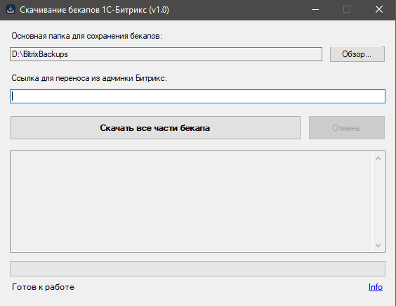

# Bitrix Backup Downloader

Лёгкая портативная утилита для Windows, предназначенная для быстрого скачивания многотомных резервных копий **1С-Битрикс** по ссылке переноса из административной панели.

Программа использует встроенный в Windows консольный загрузчик `curl.exe`, не требует установки дополнительных библиотек и распространяется в виде одного компактного `.exe` файла.

---

## Скачать программу

Вы можете скачать актуальную скомпилированную версию программы напрямую из раздела авто-релизов:

*(Если по прямой ссылке файл не скачивается, перейдите в раздел [Releases](../../releases) и выберите последний доступный выпуск).*

---

## Скриншот интерфейса

---

## Основные возможности

* **Автоматический поиск всех томов.** Утилита сама определяет количество частей многотомного архива (`.tar.gz`, `.tar.gz.1`, `.tar.gz.2` и т.д.) и останавливается ровно на последнем файле, игнорируя HTML-заглушки веб-сервера.
* **Умная сортировка по папкам.** Программа извлекает домен сайта и дату создания бекапа из имени файла и автоматически создает подпапку вида `example.ru_2026-11-18`.
* **Информативный прогресс-бар.** Отображает общий прогресс по всему объему бекапа, текущую скорость загрузки (МБ/с), прошедшее время и примерное время до завершения (ETA).
* **Докачка при обрыве связи.** Поддерживает возобновление скачивания с места остановки (флаг `curl -C -`) при повторном запуске или нажатии кнопки «Отмена».
* **Запоминание рабочей директории.** Выбранная основная папка сохраняется рядом с программой в файле `last_folder.txt`.

---

## Инструкция по использованию

1. **Получите ссылку в 1С-Битрикс.** В административной панели сайта перейдите в *Настройки -> Инструменты -> Резервное копирование -> Список резервных копий*, нажмите на меню действий нужного архива и выберите **Получить ссылку для переноса**.
2. **Запустите утилиту.** Откройте `BitrixBackupDownloader.exe`.
3. **Выберите папку.** Нажмите **Обзор...** и укажите основную директорию, куда будут складываться резервные копии.
4. **Вставьте ссылку и запустите.** Вставьте скопированный URL в поле ссылки и нажмите **Скачать все части бекапа**.
5. **Дождитесь завершения.** После скачивания всех томов программа автоматически откроет папку с готовыми файлами в Проводнике Windows.

---

## Требования к системе

* **ОС:** Windows 10 или Windows 11 (включает встроенный `C:\Windows\System32\curl.exe`).
* **Платформа:** .NET Framework 4.5 и выше (предустановлен в Windows 10/11).
